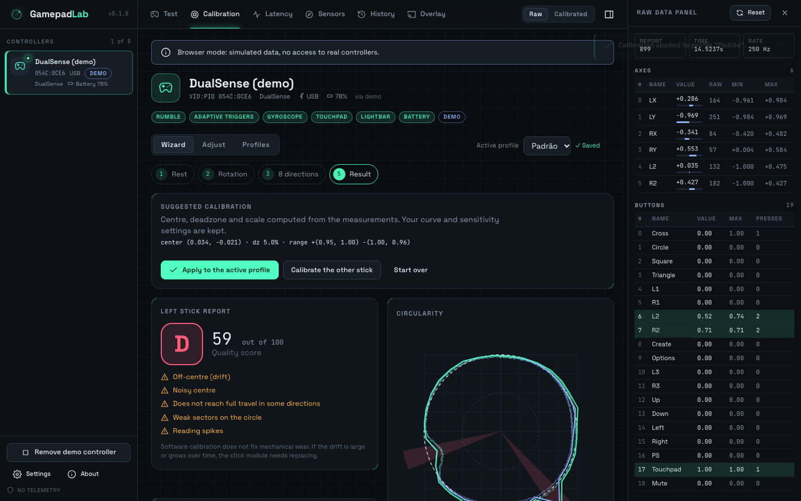
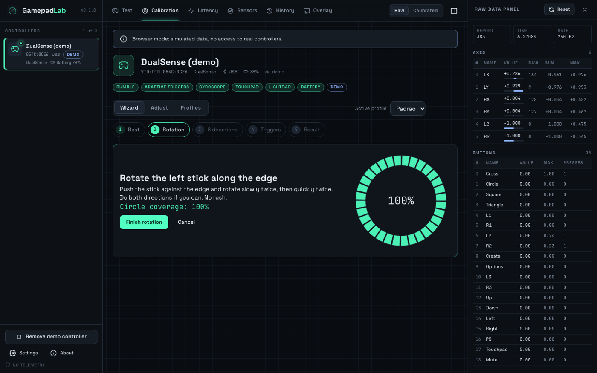
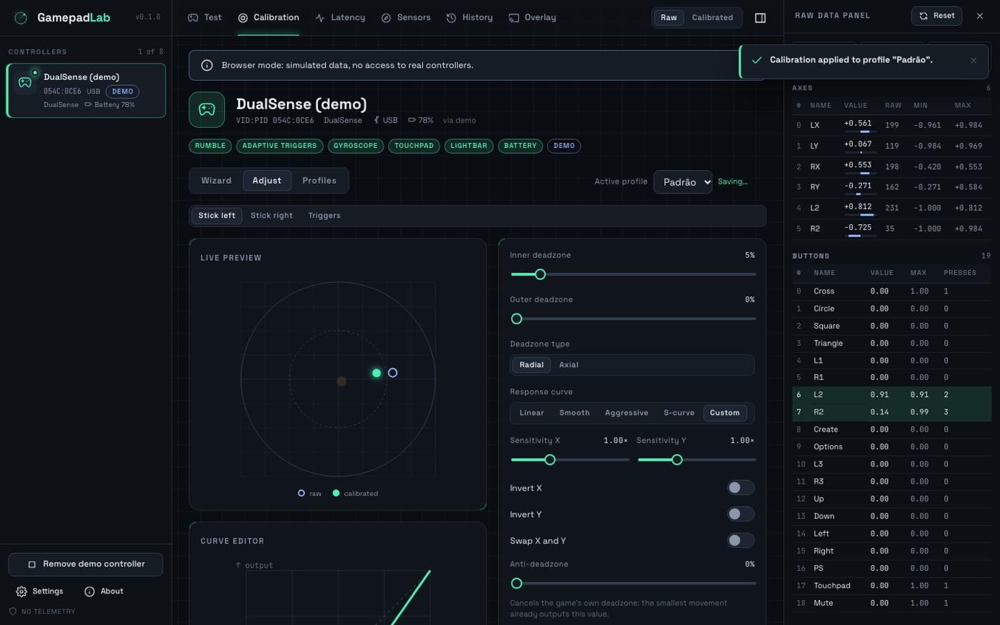
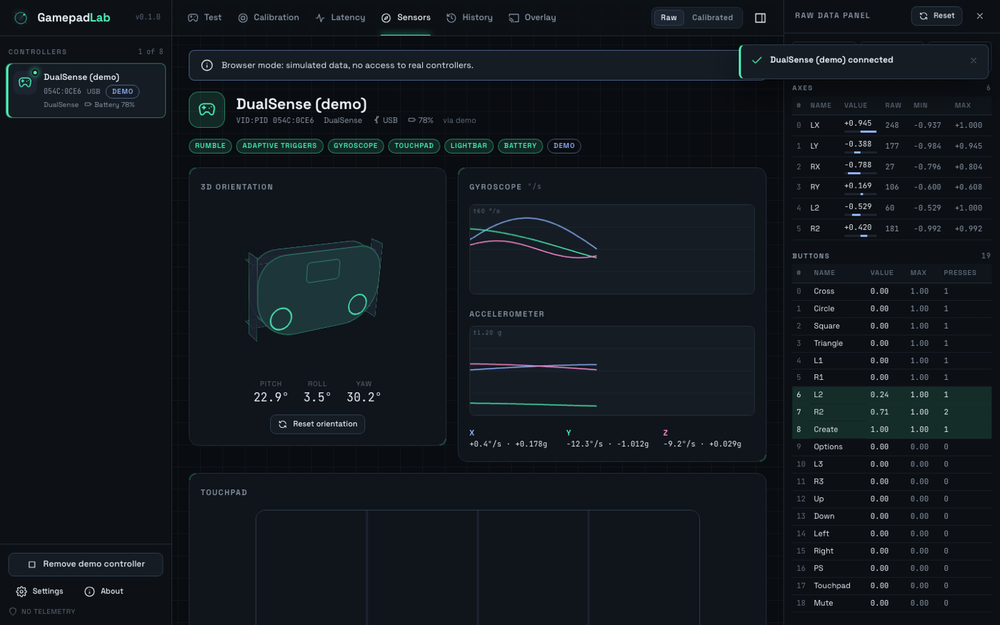
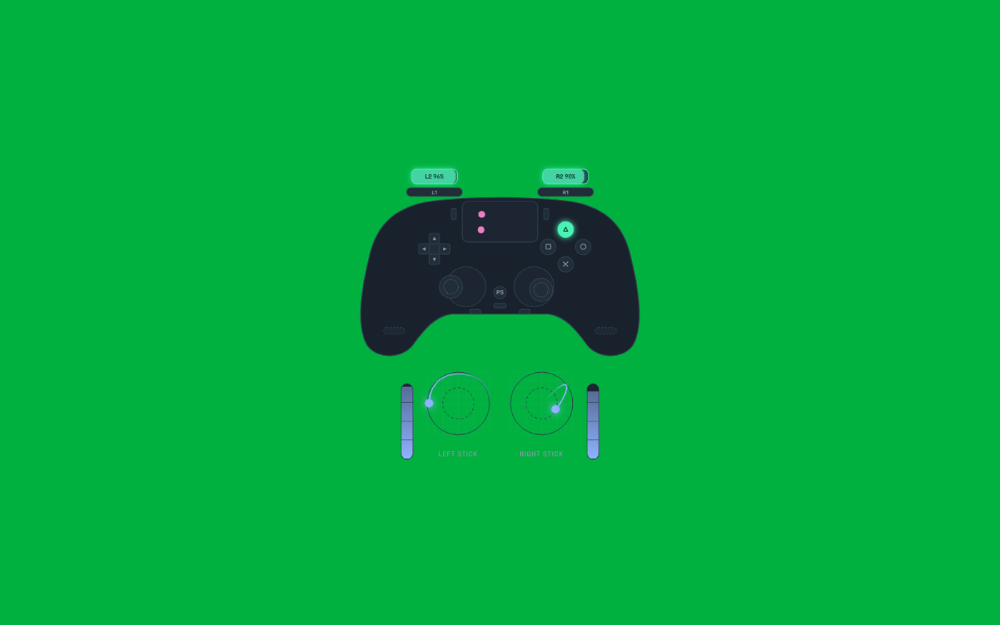

# GamepadLab

**Teste e calibração de controles de videogame no macOS, Linux e Windows.**
App desktop (Tauri 2 + Rust + React) que junta o teste completo do
[hardwaretester.com/gamepad](https://hardwaretester.com/gamepad) com a calibração guiada do
[calibrador da PG Custom](https://www.pgcustom.com.br/calibrador/calibrador-controle), e vai além:
latência real, giroscópio, touchpad, ghosting, perfis, histórico, relatórios e overlay para stream.

> **Sem telemetria.** Nada sai do seu computador. A única conexão de rede possível é a verificação
> de atualização, que é opcional e pode ser desligada em Configurações.



| Assistente | Ajustes ao vivo | Sensores | Overlay (chroma) |
|---|---|---|---|
|  |  |  |  |

## O que ele faz

**Teste do controle**
- Detecção automática e hotplug, com aviso visual e falado (leitor de tela) ao conectar e desconectar.
- Lista de até 8 controles com nome, VID:PID, conexão (USB/Bluetooth), bateria e recursos. Controles que
  aparecem duplicados (XInput + DirectInput, ou SO + HID cru) são listados uma vez só.
- Desenhos SVG para Xbox, DualShock 4, DualSense (com Edge), Switch Pro e um layout genérico que se monta
  com os botões e eixos encontrados. Botões acendem com o valor analógico; analógicos com rastro, X/Y,
  ângulo e magnitude; gatilhos de 0 a 100 % com valor cru.
- Painel de dados crus: cada eixo e botão com índice, valor, valor cru do relatório HID, mínimo e máximo
  vistos e número de toques, com botão de resetar.
- Teste guiado de botões (sem limite de tempo, com aviso de botão trocado), teste de ghosting/rollover,
  vibração com motores separados, intensidade, duração e padrões (pulso, onda, rampas, batimento), e no
  DualSense gatilhos adaptativos, LED e LEDs de jogador.
- Latência e polling: Hz real, jitter, mínimo/médio/máximo, P99, gráfico ao vivo, histograma e medição de 10 s.
- Sensores: giroscópio, acelerômetro, orientação 3D e touchpad (DS4, DualSense; Switch Pro experimental).
- Vários controles ao mesmo tempo, com abas e visão "todos ao vivo".
- Overlay para stream: janela pequena, sem bordas, sempre no topo, com fundo transparente ou chroma key.

**Calibração** (por software, em perfis; nada é gravado no controle)
- Assistente em 5 passos: repouso (2 s), rotação na borda, 8 direções, gatilhos e resultado com nota.
- Análises: gráfico circular de cobertura com o círculo ideal e setores com problema, circularidade em %,
  erro médio (RMS), raios mín/médio/máx, drift do centro em X/Y com classificação, deadzone sugerida a
  partir do ruído, curso incompleto com sugestão de reescala, spikes, saltos e ruído de potenciômetro,
  comparação antes e depois.
- Ajustes com prévia ao vivo: deadzone interna e externa (radial ou axial), curvas linear, suave, agressiva,
  S e personalizada com pontos arrastáveis, sensibilidade por eixo, inverter e trocar eixos, anti-deadzone,
  gate (círculo, octógono, quadrado) e gatilhos (deadzone, limite máximo, ponto de ativação, modo digital).
- Perfis por controle (VID:PID + número de série), vários por controle, troca rápida, duplicar, renomear,
  resetar para o padrão de fábrica, exportar e importar JSON com validação e migração de versão.
- Tudo o que o teste mostra pode ser visto cru ou calibrado (botão **Cru / Calibrado** no topo).

**Extras**
- Temas escuro, claro e automático, alto contraste, tamanho de texto, animações reduzidas.
- PT-BR e inglês (arquivos de tradução separados, com teste de paridade).
- Acessibilidade: navegação 100 % por teclado, leitor de tela (regiões ao vivo e rótulos), retorno visual
  para toda vibração, nenhum passo depende de áudio ou de tempo apertado, e dá para **navegar pelo app com o
  próprio controle** (PS/Xbox/Home ou Select+Start liga e desliga).
- Histórico local em SQLite e relatórios em PNG, PDF e JSON.
- Modo demo: um DualSense simulado (com drift, setor fraco, spikes e um gatilho que não chega a 100 %) mostra
  todas as telas funcionando sem controle físico.
- Logs estruturados (JSON) com nível ajustável e botão **Copiar diagnóstico**.

## Instalar

Baixe o instalador na página de **Releases**:

| Sistema | Arquivo |
|---|---|
| macOS (Apple Silicon / Intel) | `GamepadLab_x.y.z_aarch64.dmg` / `GamepadLab_x.y.z_x64.dmg` |
| Linux | `GamepadLab_x.y.z_amd64.AppImage` ou `.deb` |
| Windows | `GamepadLab_x.y.z_x64_pt-BR.msi` |

Depois de instalar, veja as **permissões** do seu sistema:
[macOS](docs/platforms/macos.md) · [Linux](docs/platforms/linux.md) · [Windows](docs/platforms/windows.md).

## Rodar a partir do código

Requisitos: **Rust 1.80+**, **Node 20+** e as dependências do Tauri 2 para o seu sistema:

- **macOS**: Xcode Command Line Tools (`xcode-select --install`).
- **Linux (Debian/Ubuntu)**:
  ```bash
  sudo apt install libwebkit2gtk-4.1-dev libappindicator3-dev librsvg2-dev patchelf libudev-dev build-essential
  ```
- **Windows**: Visual Studio Build Tools (C++), WebView2 (já vem no Windows 11) e, para o MSI, o WiX é baixado sozinho pelo Tauri.

```bash
npm install
npm run tauri dev
```

Gerar o instalador do seu sistema:

```bash
npm run tauri build
```

Os arquivos ficam em `target/release/bundle/` (`macos/` e `dmg/` no macOS, `deb/` e `appimage/` no Linux,
`msi/` no Windows). Para Intel no Mac com Apple Silicon: `npm run tauri build -- --target x86_64-apple-darwin`
(depois de `rustup target add x86_64-apple-darwin`).

Para mexer só na interface no navegador (dados simulados): `npm run dev` e abra <http://localhost:1420>.

## Testes e qualidade

```bash
npm run test:rust     # cargo test --workspace (matemática, drivers HID, serviço, perfis, IPC)
npm run test:ui       # vitest (i18n, paridade TS/Rust, latência, ghosting, orientação…)
npm run test:e2e      # Playwright: fluxo principal no Chromium com o controle demo
npm run lint          # eslint + tsc + clippy -D warnings
npm run format:check  # prettier + rustfmt
```

Os testes não precisam de controle físico: o serviço de entrada roda com um backend simulado, e o teste de
IPC (`src-tauri/tests/ipc.rs`) chama os comandos reais pelo runtime de mock do Tauri.

## Arquitetura

```
crates/input        detecção, hotplug, normalização, Hz real; backends gilrs, HID (DS4/DualSense/Switch Pro), demo
crates/calibration  matemática pura: repouso/drift, circularidade, direções, spikes, gatilhos, curvas, deadzones
crates/profiles     perfis JSON versionados, migração, importação/exportação
crates/haptics      padrões de vibração, motor de reprodução, efeitos de gatilho do DualSense
src-tauri           comandos e eventos Tauri, histórico SQLite, overlay, logs
apps/ui             React + Zustand + canvas/SVG
```

Detalhes em [docs/architecture.md](docs/architecture.md) e a pesquisa inicial em [docs/research.md](docs/research.md).

## Atualizações automáticas

O updater do Tauri está configurado, mas vem desligado nesta build porque precisa das suas chaves:

1. Gere as chaves: `npm run tauri signer generate -- -w ~/.tauri/gamepadlab.key`.
2. Coloque a chave pública em `src-tauri/tauri.conf.json` → `plugins.updater.pubkey` e ajuste `endpoints`
   para o seu repositório.
3. No GitHub, crie os segredos `TAURI_SIGNING_PRIVATE_KEY` e `TAURI_SIGNING_PRIVATE_KEY_PASSWORD`.
4. Publique uma tag `v*`: o workflow `release.yml` gera os instaladores, os artefatos assinados e o `latest.json`.

Assinatura e notarização no macOS: [docs/platforms/macos.md](docs/platforms/macos.md).

## Controle virtual (fase futura)

A interface `VirtualDevice` (`crates/input/src/virtual_device.rs`) já existe para publicar um controle novo no
sistema com a calibração aplicada, para qualquer jogo usar. O que falta:

| Sistema | Caminho | Falta |
|---|---|---|
| Windows | ViGEmBus (Xbox 360 / DS4) | instalar o driver ViGEmBus, bindings do cliente e esconder o controle físico (HidHide) para não haver entrada dupla |
| Linux | `/dev/uinput` | criar o dispositivo uinput (crate `evdev`), usar a regra udev já incluída e fazer `EVIOCGRAB` no controle real |
| macOS | DriverKit (HIDDriverKit) | extensão de sistema assinada com o entitlement `com.apple.developer.driverkit.family.hid.virtual.device`, concedido pela Apple |

## Limitações conhecidas

- A calibração por software vale dentro do app (e no futuro controle virtual). O app **não grava no firmware**
  do controle, de propósito: isso pode brickar o controle e não tem volta.
- Polling: para Sony via HID, o Hz é o real (um relatório por amostra). Para controles lidos pelo sistema
  (gilrs), o Hz é medido por mudança de estado: mexa o analógico continuamente.
- Switch Pro: o IMU é experimental e só liga a pedido; vibração HD do Switch não está implementada.
- Gatilhos com vibração do Xbox (impulse triggers) não são acessíveis pelo backend atual.

## Contribuir

Veja [CONTRIBUTING.md](CONTRIBUTING.md). Para relatar um problema, use **Configurações → Copiar diagnóstico**
e cole no issue.

## Licença e créditos

MIT. Inspirado no [hardwaretester.com](https://hardwaretester.com/gamepad) e no calibrador da
[PG Custom](https://www.pgcustom.com.br/calibrador/calibrador-controle) (baseado no DualShock Calibration GUI, MIT).
Protocolos HID do DualShock 4/DualSense conforme documentados pelo driver `hid-playstation` do Linux e pela
comunidade.

---

### English

GamepadLab tests and calibrates game controllers on macOS, Linux and Windows: live buttons/sticks/triggers,
raw data with min/max, guided button test, rumble patterns, DualSense adaptive triggers and lights, gyro,
touchpad, real polling rate and jitter, ghosting, up to 8 controllers, a stream overlay, a 5-step calibration
wizard with circularity/drift/spike analysis, live-preview deadzones and curves, versioned profiles, local
SQLite history and PNG/PDF/JSON reports. No telemetry. Build with `npm install && npm run tauri dev`.
